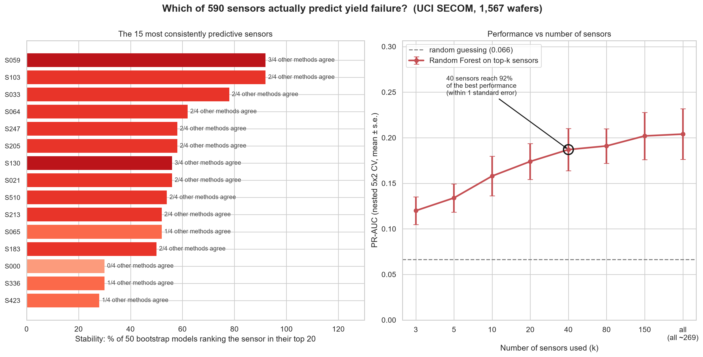
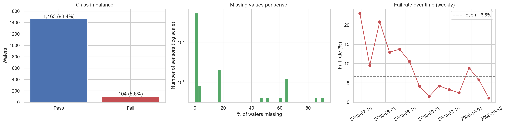
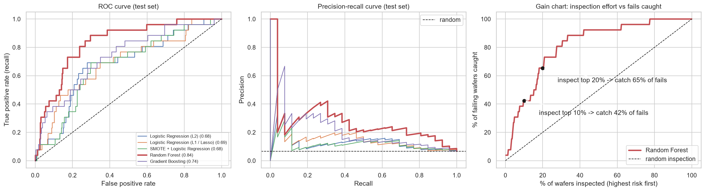
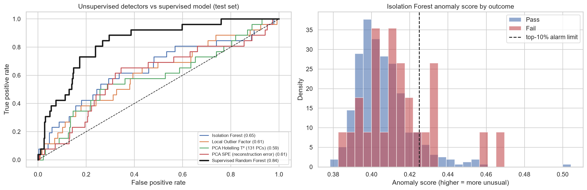
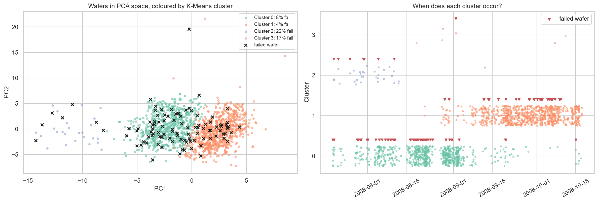

# Which of 590 sensors actually predict yield failure?

**Yield prediction, feature selection, anomaly detection and clustering on real semiconductor fab data (UCI SECOM).**



## The problem

A semiconductor fab logs hundreds of sensor readings for every wafer. Only about 7% of wafers fail final test, and most sensors are
noise. This project answers four questions a yield engineer would ask:

| Question | Technique |
|---|---|
| Can we predict which wafers will fail? | Imbalanced classification (class weights, SMOTE, Random Forest, Gradient Boosting) |
| Which sensors actually matter? | Feature selection: mutual information, Lasso, impurity and permutation importance, **stability selection**, nested top-k evaluation |
| Can we flag bad wafers without labels? | Anomaly detection: Isolation Forest, Local Outlier Factor, PCA Hotelling T² and SPE |
| Are there hidden process regimes? | PCA + K-Means clustering, silhouette analysis, chi-square test |

**Data:** [UCI SECOM](https://archive.ics.uci.edu/dataset/179/secom). 1,567 wafers × 590 anonymized sensors, Jul–Oct 2008,
104 failures (6.6%), 4.5% of readings missing.

## Key results

| | Result |
|---|---|
| Data cleaning | 590 → **269 sensors** after removing 24 mostly-empty, 116 constant and 181 redundant (\|r\| > 0.95) sensors |
| Best model (selected by cross-validation) | Random Forest with class weights |
| Test ROC-AUC | **0.83** (95% bootstrap CI 0.76–0.90) |
| Test PR-AUC | **0.28**, which is **4.2×** the random baseline of 0.066 |
| Business view | Inspecting the **top 10%** riskiest wafers catches **42%** of failures; top 20% catches 65% |
| Feature selection | **40 sensors** reach 92% of the best performance, within one standard error (nested CV) |
| Most stable sensors | S059, S103, S033, S064, S247, S205, S130, S021, S510, S213 |
| Anomaly detection (no labels) | Isolation Forest test ROC-AUC 0.65; catches 27% of failures in its top 10% alarms |
| Clustering | Clusters differ significantly in fail rate (χ² p = 6e-5); a 32-wafer early-period cluster fails at 22% (3.3×), and clusters line up with calendar periods, consistent with a process change |

### Takeaways
1. **Accuracy is useless here.** "Always pass" is 93.4% accurate. PR-AUC and a gain chart tell the real story.
2. **Most sensors don't matter.** Cleaning removes 321 of 590 (sparse, constant, redundant). Of the remainder, a few dozen carry most of the signal.
3. **Single importance charts are unreliable** with 104 failures. Stability selection across 50 bootstrap models gives a ranking you can trust.
4. **Anomalous ≠ defective.** Unsupervised detectors beat random but trail the supervised model. They are best used as early warning for new excursions.
5. **Clustering found process regimes** without seeing labels or timestamps.

## Figures

| | |
|---|---|
|  |  |
|  |  |

## Methodology notes
- **Leak-free pipeline:** a custom `SecomCleaner` scikit-learn transformer (drop sparse/constant/redundant sensors, median
  imputation) is fit inside every cross-validation fold. SMOTE runs inside an `imblearn` pipeline so synthetic samples never reach
  validation data.
- **Model selection by 5×2 repeated stratified CV** on the training set; the 25% stratified test set is used once.
- **Nested feature selection:** the top-k curve re-ranks sensors inside each fold to avoid selection bias.
- **Uncertainty:** bootstrap confidence intervals on the test metrics (the test set holds only 26 failures).

## Limitations
Sensors are anonymized, so features can't be mapped to physical parameters. With 104 failures, metrics have wide intervals. A random
split is optimistic given the drift over time; a time-based split is the stricter test. Feature importance shows association, not causation.

## Run it yourself
```bash
python -m venv .venv
.venv\Scripts\activate          # macOS/Linux: source .venv/bin/activate
pip install -r requirements.txt
jupyter notebook notebooks/secom_yield_analysis.ipynb
```
The notebook downloads the data automatically. A full run takes about 15 minutes on a laptop.

## Project structure
```
secom-yield-project/
├── notebooks/secom_yield_analysis.ipynb
├── figures/
├── data/                  # downloaded when you run the notebook (git-ignored)
└── requirements.txt
```
